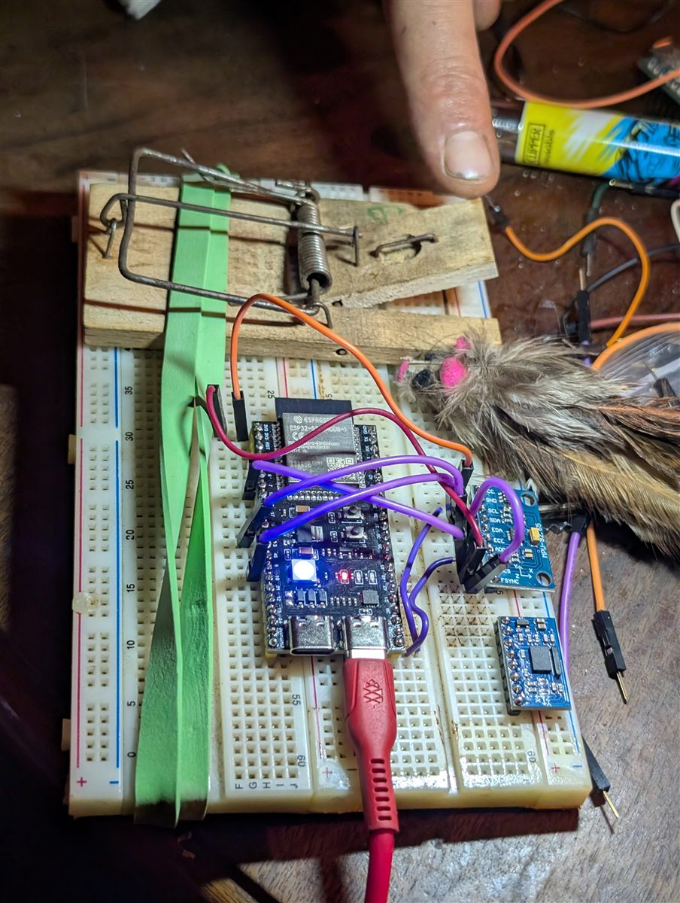
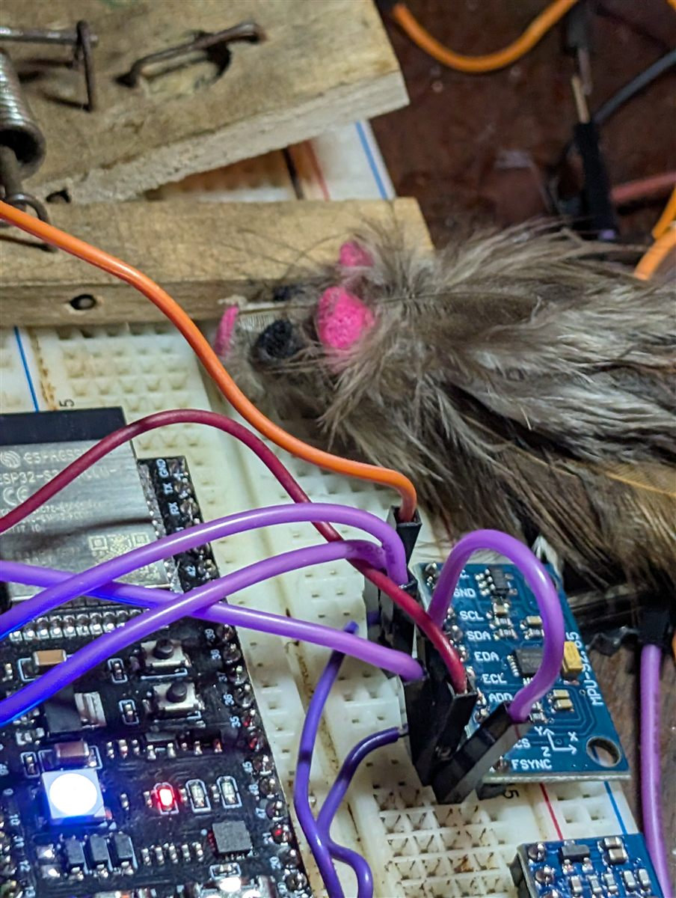
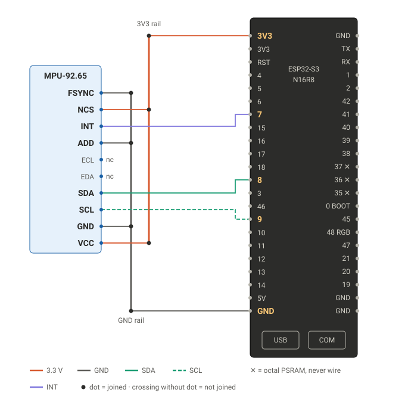
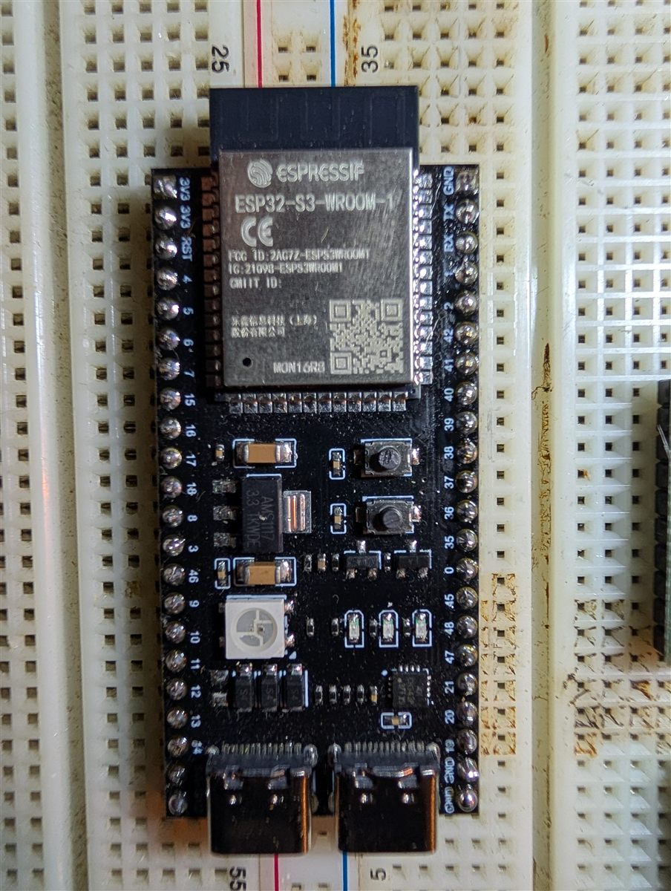
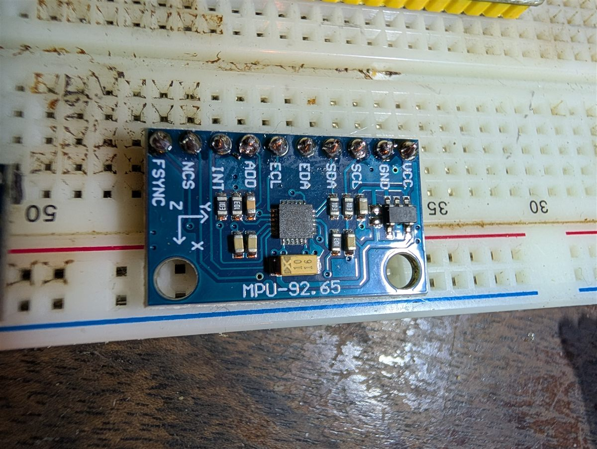
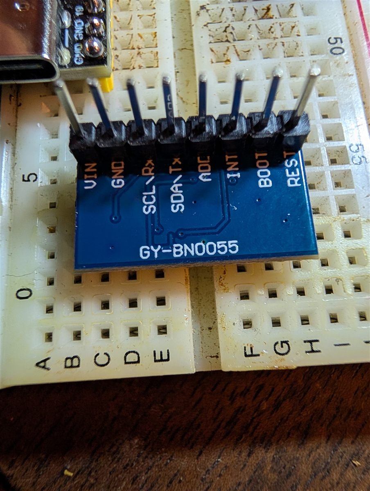
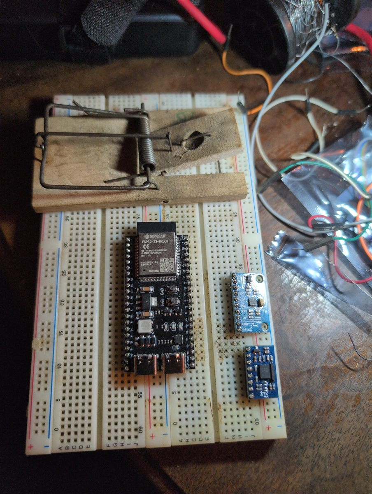

# polh-kill 🐭💥

<p align="center">
  
  
</p>

*Mousetrap snap detector for the RandeLab. An ESP32-S3 sits on ze trap, feels every vibration,
learns which one is ze real snap, and tells you on Telegram. And so on, and so on.*

🇬🇧 [English](#english) · 🇩🇪 [Deutsch](#deutsch) · 📊 **[Live captures on GitHub Pages](https://randelab.github.io/polh-kill/)** · ▶ [Ze interview](https://randelab.github.io/polh-kill/#interview)

---

## English

Look, here is the paradox. A mousetrap is the most honest machine in the world: it does one thing,
*CLACK*, and it is over. But nobody is there to hear it. So the trap waits, the mouse waits, the
cheese waits… and you, you do not know. This is unbearable. polh-kill ends this uncertainty.

### ⚡ What it does

1. **Feels**: an MPU-92.65 accelerometer is read at **1 kHz** through its FIFO (±16 g, a snap never clips).
2. **Detects**: gravity and the noise floor are tracked recursively; an impulse above `noise + k·σ`
   cuts a 1 s window (200 ms before, 800 ms after).
3. **Learns**: 12 features per event (peak, jerk, ringing frequency, FFT bands, ring-down …) feed an
   **online classifier**: naive Bayes for 6 classes (incl. 🪤 armed-trap) + **recursive least squares** for snap vs. not-snap.
   Every labelled sample updates the model immediately → [docs/learning.md](docs/learning.md).
4. **Learning lab** in the web UI: choose "snap", arm the test, let the trap go – the waveform appears,
   you keep it, the model gets smarter. Live plot, confusion matrix, dataset export.
5. **Telegram bot** (via @BotFather, like [RandeSolar](https://github.com/RandeLab/RandeSolar)): alerts with
   confidence, label buttons when it is unsure, a diary (`/howareyou`) at 20:00.
6. **Fallback hotspot "polh-kill-AP"** with captive portal: the phone pops up the setup page
   for WiFi, bot token and admin password. No WiFi? Hotspot comes back by itself.
7. **Publishes everything**: every capture is stored on the ESP (~650 waveforms, features of ~90 000)
   and pushed to **[GitHub Pages](https://randelab.github.io/polh-kill/)** as one commit per batch →
   [docs/publishing.md](docs/publishing.md).
8. **OTA**: ArduinoOTA (`pio run -e polh-ota -t upload`) and a web upload page at `/update`
   for firmware *and* web UI. The learned dataset lives on its own partition and survives both.

### 🔌 Hardware

| part | notes |
|---|---|
| ESP32-S3-WROOM-1 N16R8 DevKitC-1 (clone) | 16 MB flash, 8 MB PSRAM, RGB LED on GPIO 48 |
| MPU-92.65 breakout (MPU-6500/9250 family) | I2C: SDA 8, SCL 9, INT 7 |
| a wooden mousetrap | the classic, with the spring bar |

Wiring, pinout and why not the BNO055: [docs/wiring.md](docs/wiring.md) ·
camera evaluation: [docs/camera.md](docs/camera.md)



| ESP32-S3 N16R8 | MPU-92.65 | GY-BNO055 (not used) | first breadboard |
|---|---|---|---|
|  |  |  |  |

### 🚀 Flash

```bash
# 1. firmware over the "COM" USB-C port (CH343)
pio run -e polh -t upload
# 2. web UI into LittleFS
pio run -e polh -t uploadfs
# 3. serial log
pio device monitor
```

Later over WiFi: `pio run -e polh-ota -t upload` (and `-t uploadfs`), or upload
`firmware.bin` / `littlefs.bin` at **http://polh-kill.local/update**.
No sensor yet? `pio run -e sim -t upload` runs a simulator with "inject snap" buttons.

> Windows: if esptool hangs after compiling, set `PYTHONUTF8=1` (its Unicode progress output
> crashes on the cp1252 console when piped).

### 📶 First start

1. The RGB LED breathes blue → join the WiFi **polh-kill-AP** with your phone.
2. The setup page opens by itself (otherwise http://192.168.4.1). Enter WiFi, password,
   Telegram bot token, optionally an admin password (protects OTA and wipe).
3. polh-kill reboots into your WiFi: **http://polh-kill.local**.
4. Send `/start` to your bot – the first chat that does this becomes ze **owner**. Others can join (see below).

Long-press BOOT (3 s) opens the hotspot again at any time.

### ✈️ Telegram bot

Create it with [@BotFather](https://t.me/BotFather) (`/newbot`), copy the token into the setup page.
Optional, for nice autocompletion: `/setcommands` in BotFather with ze list below.

**More comrades, one bot.** Ze trap does not belong to one person, this would be private property.
Up to 10 people can listen to ze same bot:

- A new person sends `/start` → ze owner gets a message with **✅ let in / 🚫 no**.
- Or with ze **join code** (shown in ze web UI under ✈️ Telegram, or `/code` for ze owner):
  `/start 123456`, or simply ze link `https://t.me/<yourbot>?start=123456` – in without asking.
- Everybody gets alerts and can label events with ze buttons. Ze boot message goes only to ze owner.
- `/users` lists everybody (ze owner gets 🚪 remove buttons), `/leave` to go. In ze web UI:
  remove people, roll a new join code, or unpair everybody.
- A Telegram group also works: add ze bot to ze group, `/start` there, and ze whole group is one comrade.

| command | what |
|---|---|
| `/status` | noise floor, events, snaps, WiFi, model size |
| `/howareyou` (`/wiegehts`) | ze diary |
| `/arm` · `/disarm` | alerts on / off (disarm while resetting the trap) |
| `/stats` | pure numbers, per class |
| `/lab` | link to the learning lab |
| `/ping` | are you alive? |
| `/users` | who listens (owner: remove buttons) |
| `/code` | ze join code + link (owner only) |
| `/leave` | stop listening |

**🎙 Ze voice of ze commits.** Every commit on `main` is read aloud by ze philosopher: a GitHub Action
([voice.yml](.github/workflows/voice.yml), [tools/voice.py](tools/voice.py)) renders it as OGG onto
GitHub Pages, ze ESP finds it there and sends it as a Telegram voice message to all comrades. After
its own data pushes ze ESP sends one of ze fixed lines in [tools/voice_lines.json](tools/voice_lines.json)
(first push after boot, every snap, otherwise at most every 6 h). Ze bot token never leaves ze ESP.
Ze voice is ze Slovenian one from ze interview (sl-SI-RokNeural) reading plain English; ze few
words it gets totally wrong are fixed one by one in `FIX` in tools/voice.py. Switch off in ze web UI (🎙).

### 🌈 LED

| steady | meaning | flash | meaning |
|---|---|---|---|
| 🔵 blue breathing | hotspot open | 🔴 red blinking | **snap!** |
| 🟢 green | armed | 🟠 orange · 🔵 blue · 🟡 yellow · ⚪ white · 🩷 pink | bump · footstep · mouse · other · armed-trap |
| 🟡 yellow | disarmed | 🟣 violet | one of your own classes |
| 🟣 magenta breathing | learning test armed | 🟢 green double | sample learned |
| 🟣 magenta solid | OTA running | 🩵 cyan double | pushed to GitHub Pages |
| 🟠 orange blinking | no sensor | | |

All details: [docs/led.md](docs/led.md)

### 🗂️ Repo

```
src/        firmware (detector, features, classifier, dataset, net, telegram, web)
data/       web UI (LittleFS): index.html, app.js, style.css, mock.js
docs/       wiring, learning, camera evaluation, hardware photos
tools/      helper scripts (wiring diagram generator)
```

Open `data/index.html` directly in a browser (or with `?mock`) for an offline mock of the whole UI.

### 🔒 Secrets

There are **no** secrets in this repo. WiFi password, bot token and admin password live only in the
ESP's NVS, entered through the captive portal. Please keep it like this, comrades.

---

## Deutsch

Schau, hier ist das Paradox. Eine Mausefalle ist die ehrlichste Maschine der Welt: Sie tut genau
eine Sache, *KLACK*, und dann ist es vorbei. Aber niemand hört es. Also wartet die Falle, die Maus
wartet, der Käse wartet … und du weisst es nicht. Das ist unerträglich. polh-kill beendet diese
Ungewissheit.

### ⚡ Was es macht

1. **Fühlen**: Ein MPU-92.65-Beschleunigungssensor wird mit **1 kHz** über sein FIFO ausgelesen
   (±16 g, ein Schnapper wird nie abgeschnitten).
2. **Erkennen**: Schwerkraft und Grundrauschen werden rekursiv nachgeführt; ein Impuls über
   `Rauschen + k·σ` schneidet ein 1-s-Fenster aus (200 ms davor, 800 ms danach).
3. **Lernen**: 12 Merkmale pro Ereignis (Spitze, Ruck, Schwingfrequenz, FFT-Bänder, Ausschwingzeit …)
   gehen in einen **Online-Klassifikator**: Naive Bayes für 6 Klassen (inkl. 🪤 armed-trap) + **rekursive kleinste Quadrate**
   (RLS) für Schnapper ja/nein. Jedes gelabelte Beispiel aktualisiert das Modell sofort →
   [docs/learning.md](docs/learning.md).
4. **Lernlabor** im Webinterface: «snap» wählen, Test scharf schalten, Falle auslösen – die Kurve
   erscheint, du behältst sie, das Modell wird klüger. Live-Plot, Konfusionsmatrix, Export.
5. **Telegram-Bot** (über @BotFather, wie bei [RandeSolar](https://github.com/RandeLab/RandeSolar)):
   Alarme mit Konfidenz, Label-Knöpfe wenn er unsicher ist, Tagebuch (`/wiegehts`) um 20:00.
6. **Fallback-Hotspot «polh-kill-AP»** mit Captive Portal: Das Handy zeigt automatisch die
   Einrichtungsseite für WLAN, Bot-Token und Admin-Passwort. Kein WLAN? Der Hotspot kommt von selbst.
7. **Veröffentlicht alles**: Jede Aufnahme wird auf dem ESP gespeichert (~650 Kurven, Merkmale von ~90 000)
   und als ein Commit pro Stapel auf **[GitHub Pages](https://randelab.github.io/polh-kill/)** gepusht →
   [docs/publishing.md](docs/publishing.md).
8. **OTA**: ArduinoOTA (`pio run -e polh-ota -t upload`) und eine Upload-Seite unter `/update` für
   Firmware *und* Webinterface. Die gelernten Daten liegen auf einer eigenen Partition und überleben beides.

### 🔌 Hardware

| Teil | Bemerkung |
|---|---|
| ESP32-S3-WROOM-1 N16R8 DevKitC-1 (Klon) | 16 MB Flash, 8 MB PSRAM, RGB-LED an GPIO 48 |
| MPU-92.65-Breakout (MPU-6500/9250-Familie) | I2C: SDA 8, SCL 9, INT 7 |
| eine Holz-Mausefalle | der Klassiker mit Federbügel |

Verdrahtung, Pinbelegung und warum nicht der BNO055: [docs/wiring.md](docs/wiring.md) ·
Kamera-Abklärung: [docs/camera.md](docs/camera.md)

### 🚀 Flashen

```bash
# 1. Firmware über den «COM»-USB-C-Anschluss (CH343)
pio run -e polh -t upload
# 2. Webinterface ins LittleFS
pio run -e polh -t uploadfs
# 3. serielles Log
pio device monitor
```

Später über WLAN: `pio run -e polh-ota -t upload` (und `-t uploadfs`), oder `firmware.bin` /
`littlefs.bin` auf **http://polh-kill.local/update** hochladen.
Noch kein Sensor? `pio run -e sim -t upload` startet einen Simulator mit «inject snap»-Knöpfen.

> Windows: Falls esptool nach dem Kompilieren hängt, `PYTHONUTF8=1` setzen (seine Unicode-Fortschritts-
> anzeige stürzt in der cp1252-Konsole ab, wenn die Ausgabe umgeleitet wird).

### 📶 Erster Start

1. Die RGB-LED atmet blau → mit dem Handy ins WLAN **polh-kill-AP**.
2. Die Einrichtungsseite öffnet sich selbst (sonst http://192.168.4.1). WLAN, Passwort,
   Telegram-Bot-Token und optional ein Admin-Passwort (schützt OTA und Löschen) eingeben.
3. polh-kill startet neu und ist in deinem WLAN: **http://polh-kill.local**.
4. Dem Bot `/start` schicken – der erste Chat, der das tut, wird **Besitzer**. Weitere Leute können dazukommen (siehe unten).

BOOT lange drücken (3 s) öffnet den Hotspot jederzeit wieder.

### ✈️ Telegram-Bot

Mit [@BotFather](https://t.me/BotFather) erstellen (`/newbot`), Token in die Einrichtungsseite kopieren.
Befehle: `/status`, `/wiegehts` bzw. `/howareyou`, `/arm`, `/disarm`, `/stats`, `/lab`, `/ping`, `/users`, `/code`, `/leave`.

**Mehrere Leute, ein Bot** (bis 10): Wer neu `/start` schickt, klopft an – der Besitzer bekommt
**✅ reinlassen / 🚫 nein**. Mit dem **Beitrittscode** (Weboberfläche unter ✈️ Telegram oder `/code`)
geht es ohne Nachfrage: `/start 123456` oder der Link `https://t.me/<deinbot>?start=123456`.
Alle bekommen Alarme und können Ereignisse beschriften. `/users` zeigt alle, `/leave` meldet ab;
in der Weboberfläche kann man Leute entfernen, einen neuen Code würfeln oder alle entkoppeln.
Eine Telegram-Gruppe geht auch: Bot in die Gruppe holen, dort `/start`.

**🎙 Sprachnachrichten:** Jeden Commit auf `main` liest der Philosoph vor. Eine GitHub Action macht
daraus eine OGG-Datei auf GitHub Pages, der ESP holt sie dort und schickt sie allen als
Telegram-Sprachnachricht. Nach eigenen Daten-Pushes schickt er feste Sätze aus `tools/voice_lines.json`
(erster Push nach dem Start, jeder Schnapper, sonst höchstens alle 6 h). Es spricht die slowenische Stimme aus
dem Interview (sl-SI-RokNeural) normales Englisch; die paar Wörter, die sie ganz falsch sagt, stehen
einzeln in `FIX` in tools/voice.py. Abschaltbar in der Weboberfläche.

### 🔒 Geheimnisse

In diesem Repo sind **keine** Geheimnisse. WLAN-Passwort, Bot-Token und Admin-Passwort liegen nur
im NVS des ESP und werden über das Captive Portal eingegeben. Bitte so lassen, Genossen.

---

<div align="center">

*Ze cheese is not ze goal. Ze cheese is ze ideology.*

[▶ **Listen to ze interview** (2 min)](https://randelab.github.io/polh-kill/#interview)

RandeLab · GPL-3.0 · hack, remix, share

</div>
