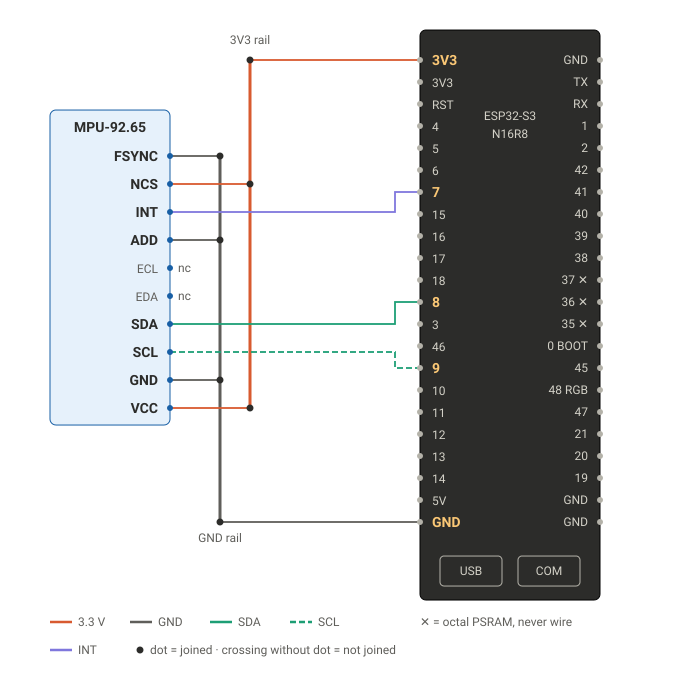

# Wiring

Board: ESP32-S3-WROOM-1 **N16R8** DevKitC-1 clone (16 MB flash, 8 MB octal PSRAM, two USB-C).
Sensor: **MPU-92.65** breakout (MPU-6500 / MPU-9250 family, the firmware reads `WHO_AM_I` and
tells you which one you really got, clones are everywhere).

| MPU-92.65 | ESP32-S3 | why |
|-----------|----------|-----|
| VCC   | 3V3 (left header, pin 1) | the breakout has its own LDO, 3V3 is fine |
| GND   | GND (left header, bottom) | |
| SCL   | GPIO 9 | I2C clock, 400 kHz |
| SDA   | GPIO 8 | I2C data |
| INT   | GPIO 7 | data-ready / wake-on-motion (battery mode later) |
| ADD (AD0) | GND | I2C address 0x68 |
| NCS   | 3V3 | keeps the chip in I2C mode (low = SPI) |
| FSYNC | GND | unused frame-sync input, do not leave it floating |
| ECL, EDA | — | auxiliary I2C for the magnetometer, not connected |

All used ESP pins sit on the **left header**. Pins in the code: `include/config.h`
(`PIN_I2C_SDA`, `PIN_I2C_SCL`, `PIN_ACC_INT`, `PIN_RGB_LED`), override per env with `-D`.

**Never use GPIO 35, 36, 37** on an N16R8: they are wired to the octal PSRAM.
On-board: RGB LED on GPIO 48, BOOT button on GPIO 0 (long press 3 s = open the setup hotspot).

## USB ports

- **COM** (CH343 USB-UART): flashing and serial log (`Serial` = UART0, 115200 baud). Use this one.
- **USB** (native ESP32-S3 USB-OTG): works for flashing too, and is free for USB-host
  experiments later (see [camera.md](camera.md)).

## Mechanics

Ze sensor must be one body with ze trap, otherwise you measure ze wobble of ze sensor, not ze snap.
Screw or hot-glue the MPU board flat onto the wooden base, close to the spring, and use short,
soft wires so the cable does not act like a second spring. If you move the sensor, record new
samples in the learning lab — the model learns *this* trap on *this* floor, and so on.

## Why not the GY-BNO055?

| | MPU-92.65 | GY-BNO055 |
|---|---|---|
| accel rate | 1 kHz (up to 4 kHz unfiltered) | up to 1 kHz bandwidth, 100 Hz fused |
| FIFO | 512 bytes, burst read | none, every sample polled |
| I2C on ESP32 | clean | uses clock stretching, known trouble |
| wake-on-motion | yes (battery mode) | yes |
| useful extra | – | absolute orientation (not needed for snaps) |

Ze BNO055 is a beautiful sensor-fusion philosopher. But we do not need philosophy here, we need
fast, raw, vulgar vibration data. So: MPU.

Regenerate the drawing with `python tools/make_wiring_svg.py`.
